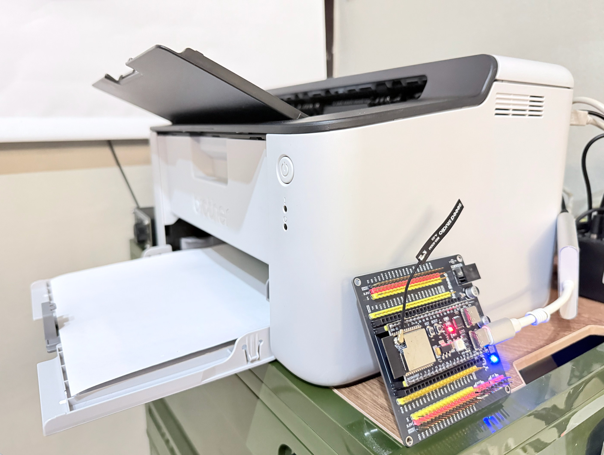

# ESP32-S3 WiFi Print Server

Turn a USB-only printer into a wireless network printer using an ESP32-S3 dev board.

> Use an ESP32-S3 dev board to turn a USB-only printer into a WiFi network printer.

<p align="center">
  
</p>

<p align="center">
  
</p>

<p align="center"><i>ESP32-S3 + Brother HL-2030 = WiFi Printer. Hello, World!</i></p>

## What It Does

This project turns an **ESP32-S3** into a transparent WiFi-to-USB print bridge. Your computer sends print data over WiFi, and the ESP32 forwards it to the printer via USB Host — no Raspberry Pi needed, just a $10 microcontroller.

```
[Computer] ~~~WiFi~~~ [ESP32-S3] ---USB--- [Printer]
```

Originally built for the **Brother HL-2030**, now adapted for the **Epson EPL-5900**. It should work with any USB printer that supports the standard USB Printer Class.

## Epson EPL-5900 Configuration

- USB identity: Epson Seiko Corp. — VID `04b8`, PID `0005`
- Network service: raw socket on port `9100`
- mDNS hostname: `epl5900.local`
- Recommended macOS/Linux/CUPS driver: Epson EPL-5900 with Gutenprint/CUPS+Gutenprint
- The ESP32 forwards the complete print stream unchanged; PCL/EPL/PostScript conversion is handled by the computer printer driver.

## Features

- **Raw Socket (Port 9100)** — JetDirect/AppSocket protocol, works natively with macOS, Windows, and Linux
- **Web Management UI** — Dark-themed dashboard to monitor printer status, configure WiFi, and restart the device
- **Auto WiFi Setup** — Boots into AP mode on first run; connect and configure via browser
- **mDNS Discovery** — Access via `hl2030.local` instead of memorizing IP addresses
- **OTA Updates** — Update firmware wirelessly from Arduino IDE
- **RGB Status LED** — Indicates WiFi/printer readiness, printing, and OTA activity
- **PSRAM Buffer** — 512KB print buffer in PSRAM handles large print jobs
- **Auto Reconnect** — Automatically reconnects to WiFi if connection drops
- **Watchdog Timer** — Auto-recovers from crashes

### RGB Status LED

The on-board RGB LED (GPIO 48) indicates the print server state:

| Color | Status |
|-------|--------|
| Orange | Starting up, WiFi disconnected, or printer not ready |
| Green | WiFi connected and printer ready |
| Blue | Printing; remains on for at least 10 seconds from the start of the job |
| Purple | OTA update in progress |
| Red | Error state |

Brightness is set to 25% by default and can be adjusted with `LED_BRIGHTNESS`
in `src/config.h`.

## Hardware Required

| Component | Notes |
|-----------|-------|
| ESP32-S3 dev board (N16R8 recommended) | Dual Type-C, 16MB Flash, 8MB PSRAM |
| USB OTG adapter | Type-C male → USB-A female, **must support OTG/Host mode** |
| USB printer cable | Type-A to Type-B (usually comes with the printer) |
| 5V USB power supply | Any phone charger works |
| **Powered USB hub (recommended)** | Provides VBUS 5V to the printer for reliable detection |

### Wiring

```
ESP32-S3 (Dual Type-C board)
├── USB Port ──► OTG Adapter ──► (Powered USB Hub) ──► Printer USB Cable ──► Printer
└── UART Port ──► 5V Power Supply (or computer for programming)
```

> **Important:** The USB OTG adapter must support Host mode. Regular charging adapters won't work. A powered USB hub between the ESP32 and printer is recommended for reliable USB device detection.

## Software Setup

### 1. Install Arduino IDE

Download [Arduino IDE 2.x](https://www.arduino.cc/en/software) and install the ESP32 board package:

- Go to **File → Preferences**
- Add to **Additional Board Manager URLs**:
  ```
  https://espressif.github.io/arduino-esp32/package_esp32_index.json
  ```
- Go to **Tools → Board → Board Manager**, search `esp32`, install **esp32 by Espressif Systems**

### 2. Board Settings

| Setting | Value |
|---------|-------|
| Board | ESP32S3 Dev Module |
| USB CDC On Boot | Disabled |
| USB Mode | USB-OTG (TinyUSB) |
| PSRAM | OPI PSRAM |
| Flash Size | 16MB (128Mb) |
| Partition Scheme | 16M Flash (3MB APP/9.9MB FATFS) |
| Upload Mode | UART0 / Hardware CDC |

> **USB Mode must be USB-OTG (TinyUSB)** for USB Host to work.

### 3. Upload

1. Connect ESP32's **UART port** to your computer
2. Open `ESP32S3_PrintServer.ino` in Arduino IDE
3. Click **Upload**
4. If upload fails, hold **BOOT**, press **RST**, release RST, wait 2 seconds, release BOOT

### PlatformIO and OTA

The PlatformIO configuration targets the N16R8: 16MB flash, OPI PSRAM, and a
16MB partition table with two OTA application slots. The first upload must be
made over serial using the `esp32-s3` environment. After WiFi has been
configured and the device is reachable on the same network, upload subsequent
firmware with:

```sh
pio run -e esp32-s3-ota -t upload
```

The OTA environment connects to `printserver.local`. If you change
`OTA_HOSTNAME` in `src/config.h`, update `upload_port` in `platformio.ini` to
match. Set a non-empty `OTA_PASSWORD` in `src/config.h` before using OTA on an
untrusted network.

## First-Time Setup

### 1. Connect Printer

1. Plug the printer into the ESP32's **USB port** via OTG adapter (use a powered USB hub if needed)
2. Power the ESP32 via the **UART port**
3. Open Serial Monitor (115200 baud) — you should see:
   ```
   [USB] VID: 0x04F9, PID: 0x002D
   [USB] Manufacturer: Brother
   [USB] Product: HL-2030 series
   [USB] ✓ Printer ready
   ```

### 2. Configure WiFi

1. Connect your phone/computer to WiFi network **PrintServer-Setup** (password: `12345678`)
2. Open **http://192.168.4.1** in your browser
3. Click **Scan** to find available networks
4. Select your WiFi, enter password, click **Connect**
5. The page will show the new IP address

### 3. Add Printer on Mac

1. Open **System Settings → Printers & Scanners**
2. Click **Add Printer**
3. Select the **IP** tab
4. Configure:

| Field | Value |
|-------|-------|
| Protocol | HP Jetdirect - Socket |
| Address | `hl2030.local` or the ESP32's IP address |
| Queue | (leave empty) |
| Name | Brother HL-2030 WiFi |
| Use | Select Brother HL-2030 driver |

5. Click **Add** — done!

### Add Printer on Windows

1. Open **Settings → Devices → Printers & Scanners**
2. Click **Add a printer or scanner**
3. Click **The printer that I want isn't listed**
4. Select **Add a printer using TCP/IP address**
5. Device type: **TCP/IP Device**
6. Hostname or IP address: ESP32's IP
7. Port: `9100`
8. Select the appropriate Brother driver

## Web Management UI

Access the dashboard at `http://hl2030.local` (or the ESP32's IP address):

- **Printer Status** — Connected/Disconnected, model info, active print job progress
- **WiFi Config** — Scan and connect to networks, signal strength
- **System Info** — Uptime, memory usage, total print jobs
- **Device Restart** — Remote restart button

## Project Structure

```
ESP32S3_PrintServer/
├── ESP32S3_PrintServer.ino   # Main sketch — setup & loop
├── config.h                  # All configuration constants
├── usb_printer.h / .cpp      # USB Host driver for printer class devices
├── wifi_manager.h / .cpp     # WiFi STA/AP management with NVS persistence
├── print_server.h / .cpp     # Raw Socket server (port 9100)
├── web_ui.h / .cpp           # Web dashboard (HTML/CSS/JS embedded)
└── GUIDE.md                  # Detailed setup guide
```

## Architecture

```
┌─────────────┐        WiFi          ┌──────────────────┐
│  Computer   │ ◄─────────────────►  │    ESP32-S3      │
│             │  Raw Socket :9100    │                  │
│  Printer    │                      │ ┌──────────────┐ │    USB    ┌────────────┐
│  Driver     │ ── print data ────►  │ │ Print Server │ │ ────────► │  Printer   │
│             │                      │ └──────────────┘ │ USB Host  │            │
│  Browser    │ ◄──── HTTP ───────►  │ ┌──────────────┐ │           └────────────┘
│             │  Dashboard :80       │ │   Web UI     │ │
└─────────────┘                      │ └──────────────┘ │
                                     │ ┌──────────────┐ │
                                     │ │ WiFi Manager │ │
                                     │ └──────────────┘ │
                                     │ ┌──────────────┐ │
                                     │ │  mDNS + OTA  │ │
                                     │ └──────────────┘ │
                                     └──────────────────┘
```

## Troubleshooting

**Printer not detected:**
- Make sure you're using a real OTG adapter (not a charging adapter)
- Use a powered USB hub between ESP32 and printer
- Try unplugging and replugging the USB cable after ESP32 boots
- Check Serial Monitor for `[USB]` messages

**Can't connect to WiFi:**
- ESP32 only supports **2.4GHz WiFi** (not 5GHz)
- Check SSID and password are correct
- If stuck, re-flash the firmware to reset WiFi settings

**Mac can't find printer:**
- Make sure Mac and ESP32 are on the same network
- Try using IP address instead of `.local` hostname
- Test connectivity: `nc -z <ESP32_IP> 9100`
- Make sure the Brother driver is installed

**Prints garbled text or blank pages:**
- Use **HP Jetdirect - Socket** protocol (not IPP or LPD)
- Select the correct printer driver (e.g., Brother HL-2030, not Generic PostScript)

## Adapting for Other Printers

This project should work with most USB printers that implement the standard USB Printer Class (bInterfaceClass = 0x07). To adapt:

1. In `usb_printer.cpp`, update the VID/PID identification in `_openDevice()` for your printer model
2. In `config.h`, update `PRINTER_NAME` and `MDNS_HOSTNAME`
3. On your computer, select the correct driver for your printer model

## Configuration

Edit `config.h` to customize:

| Constant | Default | Description |
|----------|---------|-------------|
| `AP_SSID` | `PrintServer-Setup` | AP mode network name |
| `AP_PASSWORD` | `12345678` | AP mode password |
| `MDNS_HOSTNAME` | `hl2030` | mDNS hostname (access via `<name>.local`) |
| `RAW_SOCKET_PORT` | `9100` | Print server port |
| `PRINT_BUFFER_SIZE` | `512 * 1024` | Print buffer size (in PSRAM) |
| `LED_PIN` | `48` | On-board RGB status LED GPIO pin |
| `LED_BRIGHTNESS` | `64` | LED brightness (0–255; 64 is about 25%) |
| `OTA_PASSWORD` | `""` | OTA update password (empty = no password) |
| `WDT_TIMEOUT_SEC` | `30` | Watchdog timeout in seconds |

## License

MIT License — see [LICENSE](LICENSE) for details.
Adapted for platformio and translated from https://github.com/MAXXTANG/ESP32S3_PrintServer